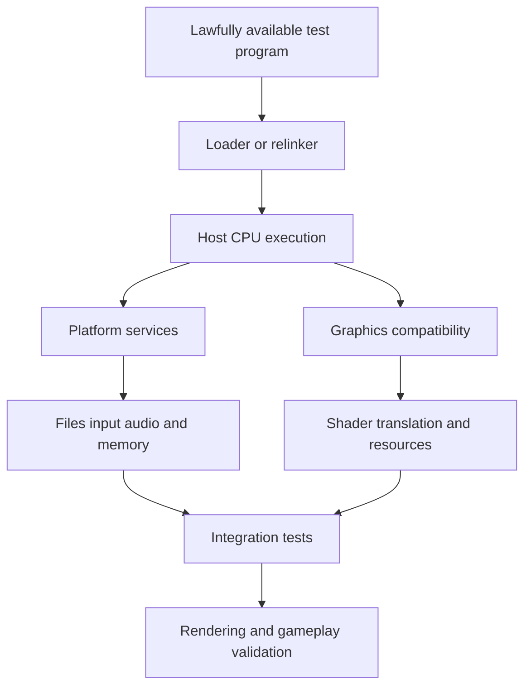

# How console-to-PC compatibility research works

Research notes, 2026-11-24. This explains the architecture and public engineering workflow, not how to obtain unreleased games or bypass access controls. Project results below are self-reported unless stated otherwise.

## 1. Why a console game is not a Windows application

Xbox Series and PS5 use AMD x86-64 CPUs and RDNA2-family graphics hardware. A desktop with a similar CPU can understand many of the same machine instructions, but that is only one part of compatibility. The executable format, calling conventions, system libraries, memory allocation, graphics interfaces, file access and platform services also have to agree. A shared instruction set does not make the platforms interchangeable.

A normal official port can use the original source code and supported development tools. Community binary compatibility work generally lacks those advantages.

## 2. Different approaches

- Native compatibility: execute compatible CPU instructions directly and implement the missing platform interfaces.
- Static recompilation: analyze machine code ahead of time and generate equivalent code for a target platform. XenonRecomp is an example for Xbox 360, a different CPU architecture.
- Dynamic recompilation: translate blocks during execution and cache the results.
- Emulation: reproduce the behavior of a target machine in software, potentially using dynamic recompilation.
- Relinking: adapt executable structure and library references to the host environment. AnyPS5 describes this approach.

Project names do not always distinguish these methods precisely. Leonida describes itself as static recompilation but much of its CPU design is native execution with a replacement runtime.

## 3. The layers

### Loader and application binary interface

A loader is responsible for arranging executable sections in memory, resolving external library references and preparing execution state. Relocations, thread-local storage, stack unwinding and initialization routines are examples of host compatibility requirements. A successful loader test with a small synthetic program establishes only the tested behavior, not compatibility with a commercial title.

### Platform libraries

A game expects services for threads, timing, synchronization, storage, controllers, audio and memory. Compatibility developers model these contracts via replacement libraries or shims. Returning a placeholder success value is not equivalent to implementing a contract: downstream code may depend on side effects, timing or resource lifetimes.

### Graphics API

A graphics compatibility layer maps the console's resource and command model to host APIs such as Vulkan or desktop Direct3D 12. Resource descriptors, barriers, queue synchronization, indirect execution, texture layouts and pipeline state are independent sources of bugs. The first successfully created graphics device is very far from a rendered world.

### Shaders

A shader is a small GPU program used in rendering or computation. Console-native GPU code may not be accepted by desktop drivers. Translation projects aim to express equivalent behavior in a host-supported representation, such as SPIR-V for Vulkan or DXIL for Direct3D.

Translation success, structural validation, driver pipeline creation and correct execution are four different milestones. A validated shader may produce incorrect results. Wave64 versus wave32 execution is one example: operations across lanes can have different semantics unless translated correctly. Tests with synthetic data and known reference outputs help identify such defects without using commercial game material.

### Resources and streaming

Textures, models and audio have their own representations. A runtime must handle data layout, decompression, memory lifetime and asynchronous streaming correctly. A standalone asset viewer demonstrates a particular data-reading capability, not a functional game runtime. This repository does not distribute assets or instructions for extracting protected files.

## 4. Public project approaches

| Project | Approach | Reported limitation |
| --- | --- | --- |
| Leonida Continued | Native x64 runtime, SPIR-V/Vulkan | README says no boot |
| LeonidaReforge | Continuation of Leonida | Inherited results not independently reproduced |
| Palmetto | Leonida-derived runtime and Vulkan | Reported compute-pipeline stop before first frame |
| Project ReCity | Leonida derivative | First-frame and shader correctness work |
| VIctory | Native x64 runtime, desktop D3D12/DXIL | Reported menus and world loading; scene rendering failed; not playable |
| Xbox2Windows | General x64 recompilation and DXIL | Diagnostic loading report; original executable startup and gameplay unverified |
| XCL | Native x64 compatibility layer and DXIL | Its unnamed game must not be assumed to be GTA VI |
| GTAVI-Recomp | PS5-specific work based on AnyPS5 | No GTA VI tests reported |
| AnyPS5 | General PS5 relinker and libraries | General library coverage is not title compatibility |

The Xbox and PS5 routes are related at the conceptual level, but their platform interfaces differ. Forks often share the same implementation and historical tests.

## 5. How developers organize the work

A useful contribution cycle is to read the upstream design and issue tracker, identify a narrowly scoped problem, coordinate ownership with maintainers, create a minimal synthetic reproduction, add a test, implement or document the fix, and submit a reviewable pull request. CI should run the regression tests. Cross-vendor graphics testing is useful because AMD, Intel and NVIDIA drivers can expose different behavior.

Examples of safe work without proprietary game files include synthetic shader tests, public API documentation, unit tests for synchronization or memory behavior, build tooling, CI improvements, and reviewing open-source code. Avoid untrusted binaries and do not attach copyrighted files to issue reports.

A good issue contains the upstream commit, operating system, compiler, GPU and driver if relevant, observed behavior, expected behavior, minimal legal reproduction and sanitized logs. It distinguishes a failure from an unsupported or untested case.

## 6. What progress actually means

| Milestone | Evidence to request |
| --- | --- |
| Code compiles | Build log and source revision |
| Synthetic tests pass | Test inputs, expected outputs and CI results |
| Shader translates | Defined corpus and translation output counts |
| Shader behaves correctly | Reference comparison with host GPU results |
| Application initializes | Reproducible report identifying what ran |
| Menus render | Evidence tied to the actual application, not a mock |
| World renders | Correct scene output and reproducible results |
| Gameplay works | Sustained interaction, audio, input, saves and stability |

These milestones are not percentages of a completed port. They may overlap, regress or differ between hardware configurations. An FPS figure from a menu is not gameplay performance. A screenshot without provenance is weak evidence.

## 7. What SomethingTracker measures

The daily snapshot queries GitHub public repository metadata: accessibility, last push, stars and open issues/pull requests. It does not execute upstream code or establish compatibility. A 404 is not proof of deletion; a fork is not automatically a separate team. New entries are manually reviewed. See [METHODOLOGY.md](METHODOLOGY.md).

## 8. Reading and sources

Primary project documentation, reviewed through public web results or GitHub API on 2026-11-24:

- [Leonida Continued](https://github.com/ubiquitarianism/leonida)
- [LeonidaReforge](https://github.com/LeonidaReforge/Leonida)
- [Palmetto](https://github.com/luizwidmer/palmetto)
- [Project ReCity](https://github.com/pixl27/ProjectReCity)
- [VIctory](https://github.com/Marvisak/VIctory)
- [Xbox2Windows](https://github.com/R0Y00/Xbox2Windows)
- [XCL](https://github.com/ivall/xcl)
- [GTAVI-Recomp](https://github.com/JamesCicada/GTAVI-Recomp)
- [AnyPS5](https://github.com/boykopovar/AnyPS5)
- [XenonRecomp](https://github.com/hedge-dev/XenonRecomp)
- [Related research directory](https://github.com/Ahmet-Dedeler/awesome-gta6-reverse-engineering)

Results are snapshots of upstream descriptions, not independent compatibility or safety certifications. Nothing here implies endorsement by the publisher or permission to use leaked or protected material.
