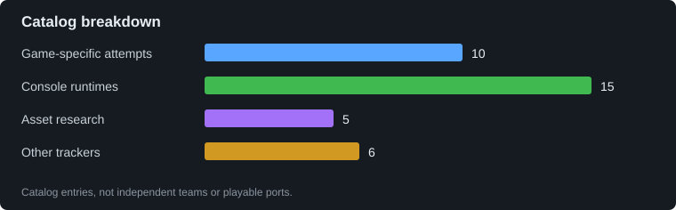

# SomethingTracker

A list of GTA VI PC port attempts, related console runtimes and research tools.

[Repository activity](STATUS.md) · [Technical guide](HOW_IT_WORKS.md) · [How tracking works](METHODOLOGY.md)

The list includes reported attempts, not confirmed working ports. Some entries may be forks or inactive projects. Detailed descriptions checked on 2026-11-24 are based on upstream READMEs; entries without a direct review are explicitly marked. No third-party game executable was tested.



## Contents

- [PC port attempts](#pc-port-attempts)
- [Console runtimes](#console-runtimes)
- [Tools and other trackers](#tools-and-other-trackers)

## PC port attempts

- [ubiquitarianism/leonida](https://github.com/ubiquitarianism/leonida)
  Continuation of NotRexed's Leonida with inherited history. The approach combines native x64 execution, replacement console services and a Vulkan graphics backend. Its README reports 26,503 translated shader records but explicitly says the game does not boot. Translation counts are not gameplay evidence.
- [LeonidaReforge/Leonida](https://github.com/LeonidaReforge/Leonida)
  Community continuation of the same upstream. Its status table is explicitly described as inherited rather than independently reproduced. Useful for following changes, but do not count inherited results twice.
- [luizwidmer/palmetto](https://github.com/luizwidmer/palmetto)
  Leonida-derived Windows runtime. Its README reports a diagnostic boot reaching compute pipeline creation, after 2,238 graphics API calls, with no rendered game frame. The documented blocker concerns shader translation and compute pipeline construction. These are maintainer measurements, not independent verification.
- [pixl27/ProjectReCity](https://github.com/pixl27/ProjectReCity)
  Leonida derivative targeting Windows and Vulkan. Its public documentation identifies first-frame rendering, wave64 behavior on narrower GPUs and unsupported model layouts as research priorities. Shared upstream history means its shader results are not an independent replication.
- [Marvisak/VIctory](https://github.com/Marvisak/VIctory)
  Native x64 runtime with desktop D3D12 graphics and on-demand DXIL shader compilation. On 2026-11-23 the README reported menus, video and world loading on a single RX 6700 XT machine, but a dark world scene and severe rendering problems. It explicitly calls the game unplayable and warns about GPU hangs. Treat this as a reported milestone only.
- [ThatRecompDev/five-star-recomp](https://github.com/ThatRecompDev/five-star-recomp)
  Game-specific toolchain candidate. Current implementation and independent results have not been verified for this entry; inspect source history and test evidence before attributing any milestone.
- [Kajcsi/G6Recomp](https://github.com/Kajcsi/G6Recomp)
  Candidate loader/recompilation project. A loader may handle binary setup without implementing graphics or system services; no specific working milestone is verified here.
- [OnlyMoisties/GTA6-BootTest](https://github.com/OnlyMoisties/GTA6-BootTest)
  Boot research candidate. A boot label alone does not establish which executable ran, whether it was a test harness, or whether a frame was rendered. No milestone verified here.
- [JamesCicada/GTAVI-Recomp](https://github.com/JamesCicada/GTAVI-Recomp)
  PS5 route built around AnyPS5's relinker, system libraries and shader compiler. The README states that no GTA VI testing has taken place and game-specific research is blocked until lawful material is available. Roadmap completion measures engineering tasks, not game compatibility.
- [SailmakerEnhance/Leonida](https://github.com/SailmakerEnhance/Leonida)
  Possible Leonida derivative. Compare upstream history before treating it as a separate implementation or counting inherited shader results.

Historical upstream: `ItsNotRexed/Leonida` and `ProjectLeonida/Leonida` returned API 404 on 2026-11-24, although indexed web copies remain visible. Public accessibility is unresolved; the continuations above preserve some of the history. `realdody/americas-recomp` was also inaccessible in the initial API review.

## Console runtimes

- [R0Y00/Xbox2Windows](https://github.com/R0Y00/Xbox2Windows)
  General Scarlett recompilation research covering x64-to-C++ conversion and desktop DXIL shaders. The README describes an offline diagnostic run reaching loading after setup, while original executable startup, interactive main menu and gameplay remain unverified. Public synthetic tests are useful without game files.
- [ivall/xcl](https://github.com/ivall/xcl)
  Windows compatibility layer replacing console APIs while running x64 code natively. It targets desktop DXIL via HLSL translation and reports tests on several named games. Its unnamed newer-game report must not automatically be attributed to GTA VI.
- [omonkeyz/xbox-emulator](https://github.com/omonkeyz/xbox-emulator)
  Xbox runtime. This is a directory classification, not a verified capability report. Consult the upstream README, source and tests for its actual scope.
- [drycheetah84/TomBox](https://github.com/drycheetah84/TomBox)
  Related Xbox compatibility project. This is a directory classification, not a verified capability report. Consult the upstream README, source and tests for its actual scope.
- [californiaAlmonds/OpenScarlett](https://github.com/californiaAlmonds/OpenScarlett)
  Xbox Series translation layer. This is a directory classification, not a verified capability report. Consult the upstream README, source and tests for its actual scope.
- [OpenCommunityEdition/OpenScarlett](https://github.com/OpenCommunityEdition/OpenScarlett)
  Distinct OpenScarlett implementation. This is a directory classification, not a verified capability report. Consult the upstream README, source and tests for its actual scope.
- [Freminet/ScarlettX](https://github.com/Freminet/ScarlettX)
  Xbox Series compatibility. This is a directory classification, not a verified capability report. Consult the upstream README, source and tests for its actual scope.
- [sammwyy/xvalkyrie](https://github.com/sammwyy/xvalkyrie)
  Xbox family translation. This is a directory classification, not a verified capability report. Consult the upstream README, source and tests for its actual scope.
- [brcly/TuxBox](https://github.com/brcly/TuxBox)
  Linux / Proton path. This is a directory classification, not a verified capability report. Consult the upstream README, source and tests for its actual scope.
- [rpatty-dev/PercyScarlett](https://github.com/rpatty-dev/PercyScarlett)
  Scarlett API shims. This is a directory classification, not a verified capability report. Consult the upstream README, source and tests for its actual scope.
- [LooperSalty/AnyXboxX](https://github.com/LooperSalty/AnyXboxX)
  GDK loader research. This is a directory classification, not a verified capability report. Consult the upstream README, source and tests for its actual scope.
- [Dark3581/AnyBox](https://github.com/Dark3581/AnyBox)
  Console import translation. This is a directory classification, not a verified capability report. Consult the upstream README, source and tests for its actual scope.
- [puffnfresh/rebox](https://github.com/puffnfresh/rebox)
  Linux / Wine compatibility. This is a directory classification, not a verified capability report. Consult the upstream README, source and tests for its actual scope.
- [jadeowaowa/scarlett-layer](https://github.com/jadeowaowa/scarlett-layer)
  Scarlett loader/shims. This is a directory classification, not a verified capability report. Consult the upstream README, source and tests for its actual scope.
- [boykopovar/AnyPS5](https://github.com/boykopovar/AnyPS5)
  General PS5 executable relinking and replacement system libraries for Windows/Linux. Its shader compiler produces SPIR-V; published library/function coverage measures implementation scope, not GTA VI compatibility.

## Tools and other trackers

- [rpatty-dev/PercyStar](https://github.com/rpatty-dev/PercyStar)
  Asset exploration. This is a directory classification, not a verified capability report. Consult the upstream README, source and tests for its actual scope.
- [holdmysocks/SixNG](https://github.com/holdmysocks/SixNG)
  Archive / format / model research. This is a directory classification, not a verified capability report. Consult the upstream README, source and tests for its actual scope.
- [Ahmet-Dedeler/Percy6Stars](https://github.com/Ahmet-Dedeler/Percy6Stars)
  Asset explorer fork. This is a directory classification, not a verified capability report. Consult the upstream README, source and tests for its actual scope.
- [DesignWithTommy/6to5m](https://github.com/DesignWithTommy/6to5m)
  Asset conversion to GTA V / FiveM, **not** GTA VI running on PC. This is a directory classification, not a verified capability report. Consult the upstream README, source and tests for its actual scope.
- [Ahmet-Dedeler/bcpack-rs](https://github.com/Ahmet-Dedeler/bcpack-rs)
  Texture decoding. This is a directory classification, not a verified capability report. Consult the upstream README, source and tests for its actual scope.
- [Ahmet-Dedeler/awesome-gta6-reverse-engineering](https://github.com/Ahmet-Dedeler/awesome-gta6-reverse-engineering)
  Broad reference directory. This is a directory classification, not a verified capability report. Consult the upstream README, source and tests for its actual scope.
- [fishingpvalues/gta6-pc-port-hub](https://github.com/fishingpvalues/gta6-pc-port-hub)
  Collaboration and technical blockers. This is a directory classification, not a verified capability report. Consult the upstream README, source and tests for its actual scope.
- [4lwayz/portwatch-vi](https://github.com/4lwayz/portwatch-vi)
  Existing status and clone tracker. This is a directory classification, not a verified capability report. Consult the upstream README, source and tests for its actual scope.
- [hubby121/portwatch-vi](https://github.com/hubby121/portwatch-vi)
  Tracker; relationship not assumed. This is a directory classification, not a verified capability report. Consult the upstream README, source and tests for its actual scope.
- [alan-r-henry/gta6-pc-tracker](https://github.com/alan-r-henry/gta6-pc-tracker)
  Tracks multiple routes to PC. This is a directory classification, not a verified capability report. Consult the upstream README, source and tests for its actual scope.
- [pagiii/gta6-tracker](https://github.com/pagiii/gta6-tracker)
  Tracking dashboard. This is a directory classification, not a verified capability report. Consult the upstream README, source and tests for its actual scope.

## Updates

[STATUS.md](STATUS.md) is generated daily from the GitHub API. It records repository availability, last push, stars and open issues/PRs. To refresh locally:

```sh
python scripts/update.py
```

New projects are added to the list manually. See [CONTRIBUTING.md](CONTRIBUTING.md) or open an issue if something is missing or mislabeled.

## Notes

No independently verified playable PC port was established during the initial review (2026-11-24). Repository activity does not establish that a game runs.

No game files, leaked source code, keys or executable downloads are hosted here. Do not treat linked projects or their releases as verified safe. This is an unofficial directory, independent of Rockstar Games and Take-Two Interactive.
