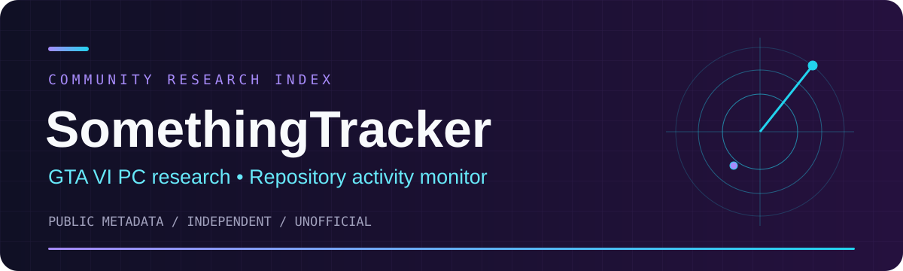

<a href="STATUS.md"><b>Activity dashboard</b></a> · <a href="#projects"><b>Project index</b></a> · <a href="METHODOLOGY.md">Methodology</a> · <a href="CONTRIBUTING.md">Contribute</a>

## At a glance

| 🎮 Game-specific attempts | ⚙️ Runtime research | 📦 Asset research | 📡 Trackers |
| :---: | :---: | :---: | :---: |
| **10** | **15** | **5** | **6** |

> Counts are catalog entries, not independent teams or working ports. See the [activity dashboard](STATUS.md) for public repository metadata.

**Community project directory and activity tracker, prepared for GitHub user `mertozkalp` (Mear).**

> [!IMPORTANT]
> This repository does **not** provide GTA VI, leaked game files, executable downloads, decryption keys, piracy instructions, or a verified playable PC build. Activity in a GitHub repository is not evidence that the game can boot or run.

## Navigation

- [Public repository links](#projects)
- [Automatically refreshed repository activity](STATUS.md)
- [Tracking methodology](METHODOLOGY.md)
- [Contribute a project](CONTRIBUTING.md)

## Scope and evidence

We track three different things separately:

1. **GTA VI-specific PC-port / static-recompilation attempts**: code explicitly targeting the console version of GTA VI on Windows.
2. **Console runtime / translation layers**: general-purpose Xbox Series or PS5 compatibility components relevant to a potential port, but **not GTA VI PC ports by themselves**.
3. **Asset tools and research / trackers**: content inspection, technical documentation, and monitoring. These **cannot** be treated as proof of gameplay on PC.

Each entry links to a public source. Descriptions refer to the project's stated goals, not independent proof of runtime compatibility. As of this index's initial preparation on **2026-11-24**, no independently verified, playable GTA VI PC port was established by the sources reviewed.

## Projects

### GTA VI-specific PC port attempts

| Project | Route | Notes |
| --- | --- | --- |
| [ubiquitarianism/leonida](https://github.com/ubiquitarianism/leonida) | Xbox Series → Windows | Separate accessible project; inspect source and history before considering claims. |
| [LeonidaReforge/Leonida](https://github.com/LeonidaReforge/Leonida) | Xbox Series → Windows | Community continuation. |
| [luizwidmer/palmetto](https://github.com/luizwidmer/palmetto) | Xbox Series → Windows | Continuation project. |
| [pixl27/ProjectReCity](https://github.com/pixl27/ProjectReCity) | Xbox Series → Windows | Static recompilation effort. |
| [Marvisak/VIctory](https://github.com/Marvisak/VIctory) | Xbox Series → Windows | Game-specific runtime research. |
| [ThatRecompDev/five-star-recomp](https://github.com/ThatRecompDev/five-star-recomp) | Xbox Series → Windows | Game-specific toolchain. |
| [Kajcsi/G6Recomp](https://github.com/Kajcsi/G6Recomp) | Xbox Series → Windows | Loader / recompilation research. |
| [OnlyMoisties/GTA6-BootTest](https://github.com/OnlyMoisties/GTA6-BootTest) | Xbox Series → Windows | Boot assertions are project claims, not independently verified. |
| [JamesCicada/GTAVI-Recomp](https://github.com/JamesCicada/GTAVI-Recomp) | PS5 → PC | Based on AnyPS5; no verified game test. |
| [SailmakerEnhance/Leonida](https://github.com/SailmakerEnhance/Leonida) | Xbox Series → Windows | Possible fork/derivative; do not count as an independent team without verification. |

**Historical/unavailable link:** [ItsNotRexed/Leonida](https://github.com/ItsNotRexed/Leonida) was inaccessible during the GitHub API check on 2026-11-24. Some copies may exist; their trustworthiness must be assessed separately. The public [realdody/americas-recomp](https://github.com/realdody/americas-recomp) link was also inaccessible when checked; it is not listed as a verified active repository.

### Console runtimes and translation layers

| Project | Relevance |
| --- | --- |
| [R0Y00/Xbox2Windows](https://github.com/R0Y00/Xbox2Windows) | Xbox x64 recompilation / graphics translation |
| [ivall/xcl](https://github.com/ivall/xcl) | Xbox Series API compatibility |
| [omonkeyz/xbox-emulator](https://github.com/omonkeyz/xbox-emulator) | Xbox runtime |
| [drycheetah84/TomBox](https://github.com/drycheetah84/TomBox) | Related Xbox compatibility project |
| [californiaAlmonds/OpenScarlett](https://github.com/californiaAlmonds/OpenScarlett) | Xbox Series translation layer |
| [OpenCommunityEdition/OpenScarlett](https://github.com/OpenCommunityEdition/OpenScarlett) | Distinct OpenScarlett implementation |
| [Freminet/ScarlettX](https://github.com/Freminet/ScarlettX) | Xbox Series compatibility |
| [sammwyy/xvalkyrie](https://github.com/sammwyy/xvalkyrie) | Xbox family translation |
| [brcly/TuxBox](https://github.com/brcly/TuxBox) | Linux / Proton path |
| [rpatty-dev/PercyScarlett](https://github.com/rpatty-dev/PercyScarlett) | Scarlett API shims |
| [LooperSalty/AnyXboxX](https://github.com/LooperSalty/AnyXboxX) | GDK loader research |
| [Dark3581/AnyBox](https://github.com/Dark3581/AnyBox) | Console import translation |
| [puffnfresh/rebox](https://github.com/puffnfresh/rebox) | Linux / Wine compatibility |
| [jadeowaowa/scarlett-layer](https://github.com/jadeowaowa/scarlett-layer) | Scarlett loader/shims |
| [boykopovar/AnyPS5](https://github.com/boykopovar/AnyPS5) | PS5 system library translation |

### Assets, documentation, and project tracking

| Project | Type |
| --- | --- |
| [rpatty-dev/PercyStar](https://github.com/rpatty-dev/PercyStar) | Asset exploration |
| [holdmysocks/SixNG](https://github.com/holdmysocks/SixNG) | Archive / format / model research |
| [Ahmet-Dedeler/Percy6Stars](https://github.com/Ahmet-Dedeler/Percy6Stars) | Asset explorer fork |
| [DesignWithTommy/6to5m](https://github.com/DesignWithTommy/6to5m) | Asset conversion to GTA V / FiveM, **not** GTA VI running on PC |
| [Ahmet-Dedeler/bcpack-rs](https://github.com/Ahmet-Dedeler/bcpack-rs) | Texture decoding |
| [Ahmet-Dedeler/awesome-gta6-reverse-engineering](https://github.com/Ahmet-Dedeler/awesome-gta6-reverse-engineering) | Broad reference directory |
| [fishingpvalues/gta6-pc-port-hub](https://github.com/fishingpvalues/gta6-pc-port-hub) | Collaboration and technical blockers |
| [4lwayz/portwatch-vi](https://github.com/4lwayz/portwatch-vi) | Existing status and clone tracker |
| [hubby121/portwatch-vi](https://github.com/hubby121/portwatch-vi) | Tracker; relationship not assumed |
| [alan-r-henry/gta6-pc-tracker](https://github.com/alan-r-henry/gta6-pc-tracker) | Tracks multiple routes to PC |
| [pagiii/gta6-tracker](https://github.com/pagiii/gta6-tracker) | Tracking dashboard |

## Automatic activity monitoring

The scheduled GitHub Actions workflow runs daily at **07:17 UTC**, pulls public metadata from the official GitHub REST API, and regenerates [STATUS.md](STATUS.md). It shows whether repositories are publicly accessible, their last push dates, stars, and open issue counts. It **does not** download or run third-party releases.

For manual refresh, run `python scripts/update.py` or GitHub Actions → **Update repository activity** → **Run workflow**. For best reliability, ensure GitHub Actions have repository `contents: write` permission. The data source is [data/projects.json](data/projects.json).

## Safety

- Treat any playable GTA VI PC installer, repack, launcher, or binary as unverified and potentially malicious.
- Never turn off antivirus or add blanket exclusions to install a claimed port.
- Verify maintainers, release signatures and source history. Never infer safety from GitHub stars.
- No game dumps, console keys or copyrighted game assets are hosted here.

**Unofficial community resource. Not affiliated with or endorsed by Rockstar Games or Take-Two Interactive.**